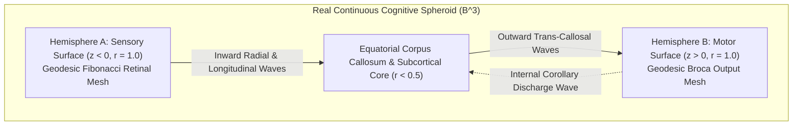
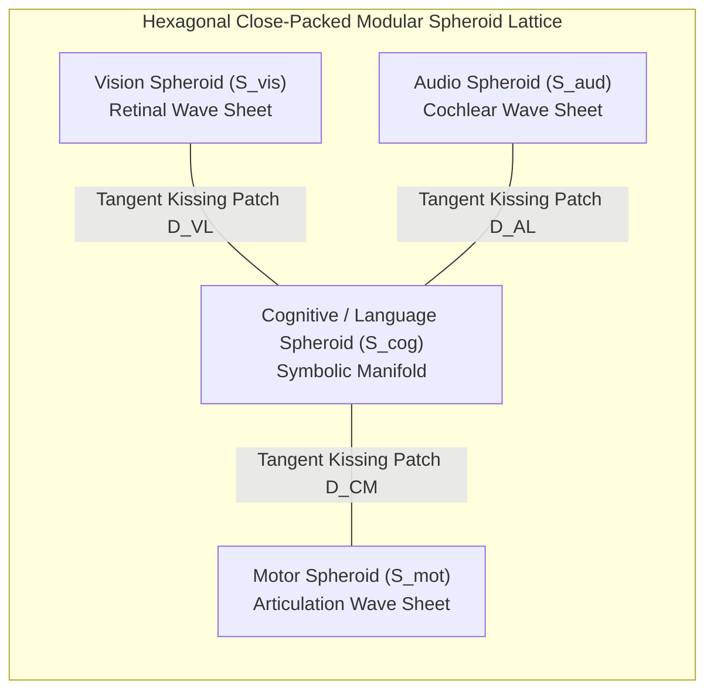

# Architectural Master Plan: The Real Continuous Spheroid & Modular Adjacent Multimodal Lattice

## Executive Summary & Diagnostic Clarification

### 1. Why Did the Prototype Become an $8 \times 8 \times 8$ Cube?
In transitioning from the Concentric Spheroid (v1) to the Bipolar Hemispheric model (v2), we used an $8 \times 8 \times 8$ regular Cartesian voxel grid with standard PyTorch `nn.Conv3d` as a **fast computational proxy** to validate the core information-flow hypothesis:
$$\text{Hemisphere A Surface } (z=0) \longrightarrow \text{3D Interior Wave Flow} \longrightarrow \text{Hemisphere B Surface } (z=7)$$

While this 3D convolutional grid validated the directional wave concept and reduced VRAM by $3.4\times$ (lowering loss from $11.08 \to 0.48$), **it is geometrically a Euclidean cube, not a Riemannian sphere**:
* **Corner Distortion**: In a cube, corners are located at $r = \sqrt{1^2 + 1^2 + 1^2} \approx 1.73$, causing anisotropic wave propagation speeds and boundary edge reflections.
* **Flat Planar Boundaries**: The input and output poles were flat 2D slices ($z=0$ and $z=7$), rather than continuous curved hemispheric surfaces ($\mathbb{S}^2$).
* **Inability to Pack Modularity**: Cubes pack into rigid brick grids, losing the unique biological properties of **spherical tangent contact patches** (kissing spheres).

---

## 2. The Real Continuous Sphere ($\mathcal{B}^3$) Formulation

### Mathematical Geometry of the True Spheroid
Rather than a cubic array, the real spheroid is modeled as the unit ball $\mathcal{B}^3 = \{\mathbf{x} \in \mathbb{R}^3 : \|\mathbf{x}\| \le 1\}$:

1. **Spherical Discretization via Geodesic Icosphere / Fibonacci Spherical Shells**:
   * The manifold consists of $K$ concentric spherical shells with radii $r_k \in (0, 1]$.
   * Each shell surface $\mathbb{S}^2(r_k)$ is tessellated with $M$ equidistant Fibonacci geodesic nodes, guaranteeing zero polar singularities and uniform surface area per node.
2. **Continuous Spherical Wave Propagation**:
   The internal wave dynamics obey the physical 3D spherical wave equation with damping:
   $$\frac{\partial^2 \Psi}{\partial t^2} = c^2 \left( \frac{1}{r^2} \frac{\partial}{\partial r} \left(r^2 \frac{\partial \Psi}{\partial r}\right) + \frac{1}{r^2} \Delta_{\mathbb{S}^2} \Psi \right) - \gamma \frac{\partial \Psi}{\partial t}$$
   where $\Delta_{\mathbb{S}^2}$ is the Laplace-Beltrami operator across the curved geodesic mesh.
3. **True Geometric Hemispheric Bipolarity**:
   * **Hemisphere A (Sensory Pole)**: All surface nodes with $z < 0$ and $r = 1$. Sensory input maps directly onto this curved dome.
   * **Hemisphere B (Motor Pole)**: All surface nodes with $z > 0$ and $r = 1$. Motor readout decodes exclusively from this opposing curved dome.
   * **Corpus Callosum**: The equatorial boundary belt ($z \approx 0$) reinforced with high-velocity axonal shortcut tracts linking symmetric nodes:
     $$\mathbf{x}_{\text{left}} = (x, y, -z) \longleftrightarrow \mathbf{x}_{\text{right}} = (x, y, +z)$$

---

## 3. Modular Adjacent Spheroids for True Multimodality

### The Vision: Why Modular Adjacent Spheres Beat Monolithic Transformers

Standard multimodal models (like GPT-4V or Gemini) take images, chop them into square patches, convert them into 1D linear tokens, and concatenate them with text tokens. This destroys the continuous geometry of vision and acoustic signals.

In the **Modular Adjacent Spheroid Network**:
1. **Dedicated Organoid Spheres**:
   * $\mathcal{S}_{\text{vis}}$: Specialized for continuous 2D retinotopic visual wave processing.
   * $\mathcal{S}_{\text{aud}}$: Specialized for tonotopic acoustic frequency wave propagation.
   * $\mathcal{S}_{\text{cog}}$: The central cognitive and symbolic reasoning spheroid.
   * $\mathcal{S}_{\text{mot}}$: The motor articulation spheroid driving language generation.
2. **Tangent Contact Patches (Kissing Sphere Interfaces)**:
   * Two identical spheres of radius $R$ centered at $\mathbf{c}_1$ and $\mathbf{c}_2$ with $\|\mathbf{c}_1 - \mathbf{c}_2\| = 2R$ touch at a single tangent point.
   * We define a circular **tangent contact disk** $\mathcal{D}_{12}$ of angular radius $\theta_{\text{contact}}$ across their opposing surfaces.
   * Signals do not become discrete tokens; continuous wave energy diffuses directly through the contact disk via a boundary flux operator:
     $$\mathbf{J}_{1 \to 2}(\mathbf{x}) = \kappa \cdot \left(\Psi_{\mathcal{S}_1}(\mathbf{x}) - \Psi_{\mathcal{S}_2}(\mathbf{x}')\right), \quad \forall \mathbf{x} \in \mathcal{D}_{12}$$
3. **True Multimodal Resonance**:
   * An image excites a continuous optical wave in $\mathcal{S}_{\text{vis}}$.
   * The wave propagates across the visual sphere and ripples through the tangent contact patch into the cognitive sphere $\mathcal{S}_{\text{cog}}$.
   * $\mathcal{S}_{\text{cog}}$ resonates across its internal corpus callosum and pushes wave energy through the motor contact patch into $\mathcal{S}_{\text{mot}}$, which emits speech.

---

## 4. Phased Implementation Roadmap

### Phase 1: Pure Geodesic Spheroid Engine (`src/real_sphere.py`)
* Replace the $8 \times 8 \times 8$ Cartesian cube with a true 3D spherical mesh:
  * $K=8$ concentric spherical shells with Fibonacci geodesic surface tessellation.
  * Implement the discrete geodesic Laplace-Beltrami operator on $\mathbb{S}^2$.
  * Implement radial inter-shell wave conduction $\frac{\partial}{\partial r}$.
* Enforce strict hemispheric bipolarity on the curved surface:
  * Hemisphere A ($z \le 0, r=1$) $\to$ Sensory Afferent.
  * Hemisphere B ($z \ge 0, r=1$) $\to$ Motor Efferent.
  * Internal Subcortical Core ($r \le 0.25$) $\to$ Corollary Discharge Sink.

### Phase 2: Active Reasoning & Cognitive Validation
* Benchmark the true geodesic sphere on our 50,000-sample multi-domain reasoning dataset.
* Verify wave dispersion characteristics on curved spherical geometry vs. Cartesian cubic corners.
* Measure loss convergence and multi-cycle deliberation depth scaling ($N \in \{1, 3, 6\}$).

### Phase 3: The Tangent Contact Interface (`src/modular_sphere_coupler.py`)
* Implement the mathematical contact patch operator between two tangent spheres $\mathcal{S}_A$ and $\mathcal{S}_B$.
* Parameterize the circular transfer disk $\mathcal{D}_{AB}$ with trainable cross-flux weights $\kappa_{AB}$.
* Test dual-sphere coupling: Language Sphere $\mathcal{S}_{\text{cog}}$ coupled to Motor Sphere $\mathcal{S}_{\text{mot}}$.

### Phase 4: Full Multimodal Adjacent Cluster (Vision + Language)
* Build the 3-Sphere Cluster: $\mathcal{S}_{\text{vis}} \longleftrightarrow \mathcal{S}_{\text{cog}} \longleftrightarrow \mathcal{S}_{\text{mot}}$.
* Feed an image into $\mathcal{S}_{\text{vis}}$, allow continuous wave flux to diffuse into $\mathcal{S}_{\text{cog}}$, and articulate the description through $\mathcal{S}_{\text{mot}}$.
